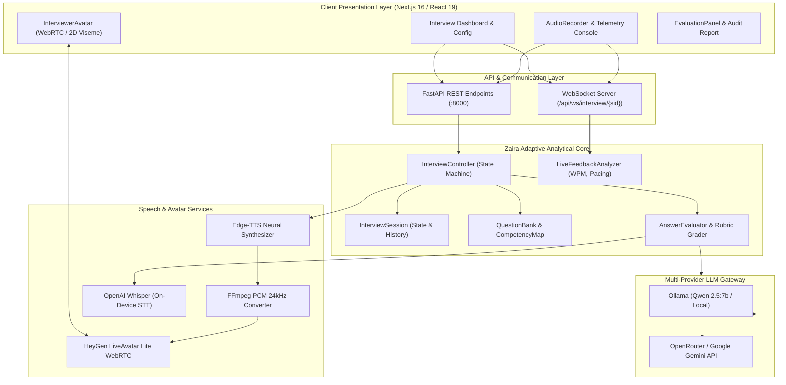
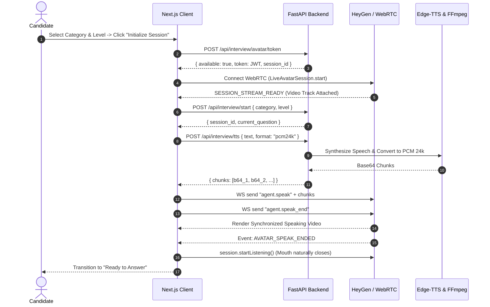
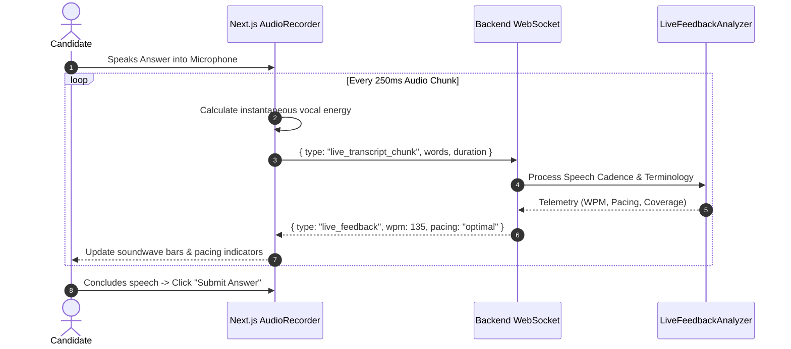
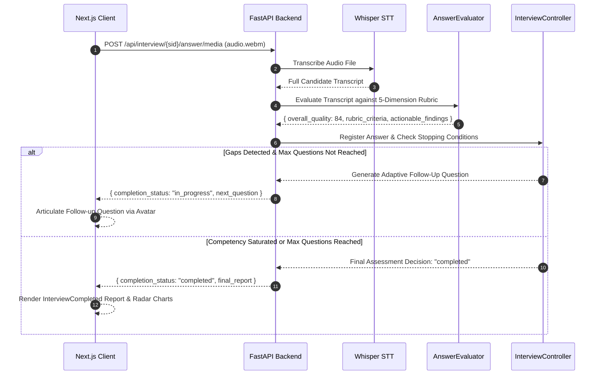

# High-Level Design (HLD)

## Project: TruthLens AI & Zaira AI Interviewer Suite
**Document Version:** 1.0.0  
**Status:** Approved  
**Author:** Engineering & Product Team  
**Date:** November 2026  
**Repository:** [https://github.com/Santhosh082006/zaira-ai](https://github.com/Santhosh082006/zaira-ai)

---

## 1. System Context & Overview

TruthLens AI & Zaira AI provide a real-time, multimodal spoken interview assessment architecture designed to simulate an elite technical panelist. The system comprises two collaborative layers:
1. **Interactive Spoken Interviewer (Zaira AI)**: A reactive front-facing client with an audio-synchronized virtual interviewer, live audio recorder, bidirectional WebSocket telemetry, and adaptive questioning.
2. **Analytical & Evaluative Backend**: A high-performance Python FastAPI engine orchestrating OpenAI Whisper transcription, multi-provider LLM evaluations, adaptive state machines, and real-time speech prosody synthesis.

---

## 2. Subsystem Architecture

### 2.1 Frontend Client Subsystem (Next.js 16 + React 19)
- **Role**: Drives candidate interaction, renders the virtual interviewer, captures webcam and microphone streams, and renders real-time rubric scoreboards.
- **Key Modules**:
  - `InterviewDashboard.tsx`: Root controller managing interview phases (`CONFIG`, `READY`, `PROCESSING`, `ANSWER_RESULT`, `COMPLETED`).
  - `InterviewerAvatar.tsx`: Synchronized avatar component rendering either the WebRTC HeyGen stream or the local 2D anatomical viseme blend engine with Web Audio frequency analysis.
  - `AudioRecorder.tsx`: High-resolution audio capture using `MediaRecorder`, soundwave canvas visualizer, and streaming live speech transcript update hooks.
  - `useLiveAvatar.ts`: Custom React hook encapsulating HeyGen LiveAvatar Lite WebRTC lifecycle, WebSocket audio streaming (`agent.speak`), and attentive listening states.
  - `useInterviewSession.ts`: Manages REST calls and real-time WebSocket state synchronizations with the backend.

### 2.2 Backend Application Subsystem (FastAPI)
- **Role**: High-concurrency async web server handling REST session contracts, WebSocket telemetry, audio transcoding, and avatar authentication tokens.
- **Key Modules**:
  - `backend/api.py`: FastAPI application root with CORS middleware, WebSocket connection manager, and error handlers.
  - `backend/routes/interview.py`: Core REST endpoints (`/start`, `/answer`, `/retry`, `/tts`, `/avatar/token`, `/report`).
  - `backend/routes/interview_ws.py`: Real-time duplex WebSocket endpoint broadcasting `live_feedback`, `evaluation_streaming`, and `question_ready` events.
  - `backend/schemas/`: Pydantic models enforcing strict contract validations.

### 2.3 Conversational Avatar & Audio Subsystem
- **Role**: Converts written interview questions into natural conversational speech and physically animates the avatar.
- **Processing Pipeline**:
  1. **Text Formatting**: `format_conversational_speech_flow` expands acronyms phonetically and injects breath pauses.
  2. **Neural Speech Generation**: Edge-TTS generates high-fidelity audio (`en-US-AvaNeural`).
  3. **PCM 24k Transcoding**: ImageIO-FFmpeg converts audio into raw 16-bit, 24,000 Hz, mono PCM chunks.
  4. **Avatar Articulation**:
     - *Mode A (LiveAvatar Lite WebRTC)*: Base64 PCM chunks streamed to HeyGen WebSocket (`agent.speak` $\rightarrow$ `agent.speak_end`), rendering real-time synchronized video via LiveKit WebRTC.
     - *Mode B (Local 2D Viseme Engine)*: Client Web Audio Analyser measures speech energy at 60 FPS, dynamically interpolating between 5 anatomical mouth visemes (`zaira-viseme-0.png` to `4.png`).

### 2.4 Analytical & Adaptive Core Subsystem
- **Role**: Stateful intelligence controlling interview progression, difficulty calibration, and rubric scoring.
- **Key Modules**:
  - `core/interview_controller.py`: Stateful controller executing the dynamic questioning loop and stopping condition logic.
  - `core/question_bank.py`: Dynamic question catalog indexing technical, behavioral, and architectural inquiries across difficulty tiers.
  - `core/competency_map.py`: Matrix tracking competency demonstration across 8 vectors (e.g., Code Quality, System Architecture, Problem Solving).
  - `core/answer_evaluator.py`: Multi-dimensional evaluation engine analyzing candidate transcripts for factual depth, structure, and clarity.

---

## 3. End-to-End Sequence Workflows

### 3.1 Session Start & Avatar Question Articulation

### 3.2 Candidate Recording & Live Telemetry Loop

### 3.3 Answer Evaluation & Adaptive Follow-Up Questioning

---

## 4. Data Architecture & Storage Strategy

- **In-Memory Active Session Store**: Thread-safe session registry (`InterviewSessionRegistry`) holding active question chains, candidate transcripts, audio blobs, and rubric results.
- **Local Persistence & Serialization**: Completed interview sessions serialized to disk in `.sessions/{session_id}.json` with full audit logs and execution traces.
- **Pre-compiled Question Bank**: Stored in `core/questions.json` containing standardized multi-difficulty question items with targeted topics, expected concepts, and rubric criteria.

---

## 5. Security & Isolation Architecture

1. **Zero Secret Leakage**: `HEYGEN_API_KEY`, `OPENROUTER_API_KEY`, and `GEMINI_API_KEY` reside exclusively in the backend `.env`. The frontend client receives short-lived, single-use JWT session tokens with strictly scoped WebRTC room access.
2. **CORS Hardening**: Explicit origin binding allowing requests from `http://localhost:3000` with credentials support.
3. **Sandbox Compliance**: Fallback mechanisms handle network-restricted environments by defaulting to local Ollama and 2D viseme animation without external dependencies.
