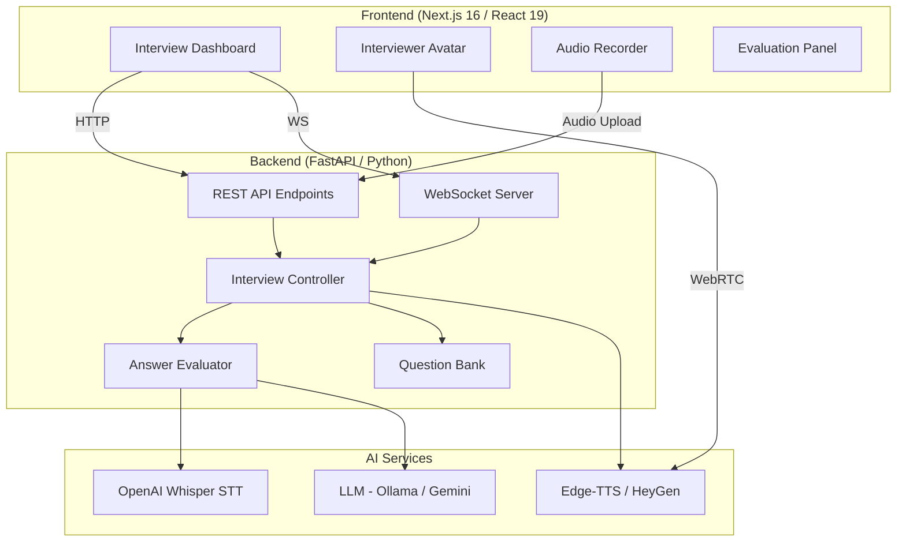

# High-Level Design (HLD)

## Project Title
**Zaira AI — Adaptive AI Interviewer**

**Author:** Santhosh (santhoshgg08@gmail.com)  
**Repository:** [https://github.com/Santhosh082006/zaira-ai](https://github.com/Santhosh082006/zaira-ai)  
**Document Version:** 1.0.0  
**Status:** Approved  

---

## System Architecture Overview
Zaira AI follows a **Client-Server architecture** with a React-based frontend communicating with a Python FastAPI backend through REST APIs and WebSockets. The system integrates external AI services for speech synthesis, speech recognition, and language model inference.

---

## Architecture Diagram

---

## Tech Stack

| Layer | Technology | Purpose |
|---|---|---|
| **Frontend** | Next.js 16, React 19, Tailwind CSS v4 | User interface, avatar rendering, audio recording |
| **Backend** | Python 3.10+, FastAPI, Uvicorn | REST API, WebSocket server, session management |
| **Speech-to-Text** | OpenAI Whisper (local) | Transcribe candidate audio answers |
| **Text-to-Speech** | Microsoft Edge-TTS | Generate interviewer speech audio |
| **Avatar** | HeyGen LiveAvatar Lite (WebRTC) | Photorealistic avatar video with lip sync |
| **LLM** | Ollama (Qwen 2.5:7b), Google Gemini, OpenRouter | Question generation, answer evaluation |
| **Real-Time** | WebSocket, WebRTC, LiveKit | Live telemetry, avatar video streaming |
| **Storage** | In-memory + JSON file persistence | Session data, transcripts, evaluation results |

---

## Core Components

### 1. Frontend Client
- **Interview Dashboard**: Manages interview phases (Config → Ready → Processing → Evaluation → Completed).
- **Interviewer Avatar**: Displays the AI interviewer using either HeyGen WebRTC video or a local 2D lip-sync engine.
- **Audio Recorder**: Captures candidate speech via browser MediaRecorder API and streams chunks over WebSocket.
- **Evaluation Panel**: Renders rubric scores, strengths, weaknesses, and actionable findings.

### 2. Backend API Server
- **Interview Routes**: REST endpoints for session start, answer submission, TTS generation, and avatar token creation.
- **WebSocket Server**: Real-time bidirectional channel for live speech telemetry and coaching feedback.
- **Interview Controller**: State machine that manages adaptive questioning, difficulty calibration, and stopping conditions.

### 3. AI Services Layer
- **Whisper STT**: Transcribes candidate audio to text on-device.
- **Edge-TTS / HeyGen**: Converts question text to natural speech audio and drives avatar lip sync.
- **LLM Provider**: Multi-provider bridge supporting Ollama (offline), Google Gemini, and OpenRouter for evaluation and question generation.

---

## Data Flow

### Interview Session Flow
1. Candidate selects interview category, difficulty level, and goals on the frontend.
2. Frontend sends `POST /api/interview/start` to create a new session.
3. Backend generates an opening question using the question bank and LLM.
4. Frontend requests avatar token via `POST /api/interview/avatar/token`.
5. Avatar connects via WebRTC and speaks the question.
6. Candidate answers through the microphone; audio is recorded and uploaded.
7. Backend transcribes audio (Whisper), evaluates the answer (LLM), and generates a follow-up question.
8. Steps 5-7 repeat until competency saturation or max questions reached.
9. Backend generates a comprehensive final report with rubric scores.

### Real-Time Telemetry Flow
1. While the candidate speaks, the frontend streams live transcript chunks over WebSocket.
2. The backend calculates WPM, pacing status, and coaching hints every 250ms.
3. Live feedback is pushed back to the frontend via WebSocket for display.

---

## Deployment Architecture

| Environment | Description |
|---|---|
| **Local Development** | Backend on `localhost:8000`, Frontend on `localhost:3000`, Ollama on `localhost:11434` |
| **Docker Compose** | Single `docker compose up` command runs both services with FFmpeg included |
| **Offline Mode** | Fully functional with local Ollama and Whisper, no internet required |

---

## Security Considerations
- API keys (`HEYGEN_API_KEY`, `OPENROUTER_API_KEY`, `GEMINI_API_KEY`) stored exclusively in backend `.env` file.
- Frontend receives only short-lived JWT session tokens for WebRTC access.
- CORS configured to allow only `http://localhost:3000`.
- Audio recordings processed locally and not stored permanently by default.
