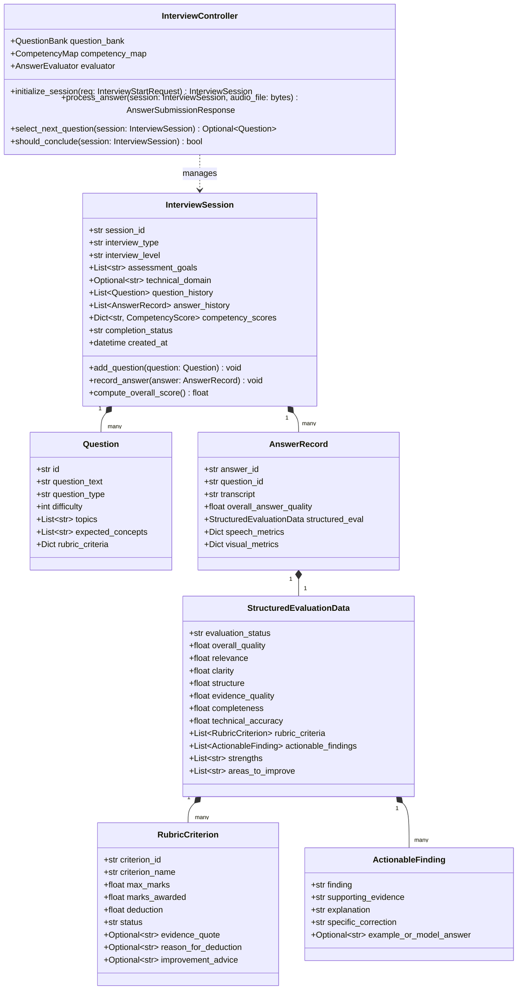

# Low-Level Design (LLD)

## Project: TruthLens AI & Zaira AI Interviewer Suite
**Document Version:** 1.0.0  
**Status:** Approved  
**Author:** Engineering & Product Team  
**Date:** November 2026  
**Repository:** [https://github.com/Santhosh082006/zaira-ai](https://github.com/Santhosh082006/zaira-ai)

---

## 1. Class Diagrams & Object-Oriented Models



---

## 2. Detailed REST API Specifications

### 2.1 Start Interview Session
- **Endpoint**: `POST /api/interview/start`
- **Request Body**:
  ```json
  {
    "interview_type": "technical",
    "interview_level": "intermediate",
    "assessment_goals": ["COMMUNICATION", "PERFORMANCE"],
    "technical_domain": "Python",
    "custom_goal": null,
    "resume_text": null,
    "job_description": null
  }
  ```
- **Response** (`200 OK`):
  ```json
  {
    "session_id": "sess_001c85f85f75",
    "current_question": {
      "id": "q_py_001",
      "question_text": "Could you walk me through the Python GIL, how it influences multithreading, and when you would use multiprocessing or asyncio instead?",
      "question_type": "technical",
      "difficulty": 2,
      "topics": ["Python", "Concurrency", "GIL"]
    },
    "interview_type": "technical",
    "interview_level": "intermediate",
    "completion_status": "in_progress",
    "interview_progress": 0.15
  }
  ```

### 2.2 Submit Candidate Media Answer
- **Endpoint**: `POST /api/interview/{session_id}/answer/media`
- **Content-Type**: `multipart/form-data`
- **Form Fields**:
  - `question_id`: `q_py_001`
  - `file`: `audio.webm` (Binary audio/video payload)
- **Response** (`200 OK`):
  ```json
  {
    "session_id": "sess_001c85f85f75",
    "answer_id": "ans_9a12c8b7",
    "processed_question_id": "q_py_001",
    "transcript": "The Global Interpreter Lock ensures only one thread executes Python bytecode...",
    "overall_answer_quality": 85.0,
    "detected_strengths": ["Clear explanation of GIL mutex mechanism", "Practical multiprocessing distinction"],
    "detected_weaknesses": ["Omitted asyncio event loop single-threaded cooperative multitasking context"],
    "structured_evaluation": {
      "evaluation_status": "success",
      "overall_quality": 85.0,
      "relevance": 90.0,
      "clarity": 85.0,
      "technical_accuracy": 88.0,
      "rubric_criteria": [
        {
          "criterion_id": "gil_concept",
          "criterion_name": "GIL Mechanism & Thread Safety",
          "max_marks": 25.0,
          "marks_awarded": 25.0,
          "deduction": 0.0,
          "status": "full_credit",
          "evidence_quote": "The Global Interpreter Lock ensures only one thread executes Python bytecode..."
        }
      ],
      "actionable_findings": [
        {
          "finding": "AsyncIO event loop mechanics omitted",
          "supporting_evidence": "Candidate mentioned multiprocessing but did not detail asyncio.",
          "explanation": "AsyncIO operates on a single thread using an event loop with non-blocking I/O.",
          "specific_correction": "Mention that asyncio uses cooperative multitasking for I/O-bound concurrency."
        }
      ]
    },
    "next_question": {
      "id": "q_py_followup_002",
      "question_text": "Building on that, how does an asyncio event loop handle high-concurrency network calls without spawning multiple OS threads?",
      "difficulty": 3
    },
    "completion_status": "in_progress",
    "interview_progress": 0.40
  }
  ```

### 2.3 Generate LiveAvatar Lite Session Token
- **Endpoint**: `POST /api/interview/avatar/token`
- **Headers**: Internal session token
- **Response** (`200 OK`):
  ```json
  {
    "available": true,
    "provider": "heygen_liveavatar",
    "token": "eyJhbGciOiJIUzI1NiIsInR5cCI6IkpXVCJ9...",
    "session_id": "088efb78-e3ab-430c-ab54-8d4e20b00daf",
    "avatar_id": "56c84371-a65c-4f11-83f5-afcf4ec48fb4",
    "voice_id": "b1200469-775a-415b-bd67-8967797f6fcb",
    "message": "LiveAvatar Lite session token generated successfully."
  }
  ```

### 2.4 Synthesize Question Audio (PCM 24k)
- **Endpoint**: `POST /api/interview/tts`
- **Request Body**:
  ```json
  {
    "text": "Could you walk me through your journey in software engineering?",
    "voice": "en-US-AvaNeural",
    "rate": "-3%",
    "conversational_flow": true,
    "audio_format": "pcm24k"
  }
  ```
- **Response** (`200 OK`):
  ```json
  {
    "status": "success",
    "format": "pcm_s16le",
    "sample_rate": 24000,
    "channels": 1,
    "duration_sec": 3.84,
    "total_bytes": 184320,
    "chunks": [
      "<Base64 PCM Chunk 1 - 400ms>",
      "<Base64 PCM Chunk 2 - 1000ms>",
      "<Base64 PCM Chunk 3 - 1000ms>"
    ]
  }
  ```

---

## 3. WebSocket Protocol Specification

- **Path**: `ws://localhost:8000/api/ws/interview/{session_id}`
- **Protocol**: JSON framed text messages

### Client Messages to Server
| Type | Fields | Purpose |
| :--- | :--- | :--- |
| `live_transcript_chunk` | `text`, `is_final`, `duration_sec`, `word_count` | Candidate live speech stream from browser STT |
| `heartbeat` | `timestamp` | Connection keepalive every 15s |

### Server Messages to Client
| Type | Fields | Description |
| :--- | :--- | :--- |
| `connected` | `session_id`, `status` | Acknowledges WebSocket channel binding |
| `live_feedback` | `word_count`, `wpm`, `pacing_status`, `concepts_covered`, `coaching_hint` | Emitted every 250ms to drive on-screen feedback bars |
| `question_ready` | `question` | Broadcasts new adaptive question |
| `evaluation_streaming` | `stage`, `progress`, `message`, `thought_trace` | In-flight progress during deep LLM rubric scoring |
| `interview_completed` | `session_id`, `report` | Signals session termination and triggers final report view |

---

## 4. Key Algorithms & Mathematical Formulations

### 4.1 Acoustic Energy & Viseme Mapping Algorithm
Real-time 60 FPS loop analyzing audio frequency bins from the Web Audio API:
$$\text{Energy} = \min\left(1.0, \frac{\sum_{i=2}^{24} \text{FreqBin}[i]}{23 \times 255} \times 1.6\right)$$

Viseme state selection:
$$\text{Viseme} = \begin{cases} 
0 \text{ (Resting Smile)}, & \text{Energy} < 0.08 \\
1 \text{ (Soft Consonant)}, & 0.08 \le \text{Energy} < 0.25 \\
2 \text{ (Active Vowel)}, & 0.25 \le \text{Energy} < 0.50 \\
3 \text{ (Open Vowel)}, & 0.50 \le \text{Energy} < 0.75 \\
4 \text{ (Rounded Vowel)}, & \text{Energy} \ge 0.75 
\end{cases}$$

### 4.2 Speech Pacing & Words Per Minute (WPM)
Candidate pacing classification based on running transcript duration:
$$\text{WPM} = \frac{\text{Total Words}}{\text{Speaking Time in Seconds}} \times 60$$

$$\text{Pacing Status} = \begin{cases} 
\text{"too\_slow"}, & \text{WPM} < 105 \\
\text{"optimal"}, & 105 \le \text{WPM} \le 165 \\
\text{"too\_fast"}, & \text{WPM} > 165 
\end{cases}$$

### 4.3 Adaptive Difficulty Transition Formula
The next question's target difficulty $D_{t+1}$ adjusts based on previous question performance:
$$D_{t+1} = \operatorname{clamp}\left(1, 4, D_t + \Delta D\right)$$
$$\Delta D = \begin{cases} 
+1, & \text{Score} \ge 85 \text{ and } D_t < 4 \\
0, & 65 \le \text{Score} < 85 \\
-1, & \text{Score} < 65 \text{ and } D_t > 1 
\end{cases}$$

### 4.4 LiveAvatar Lite WebSocket Frame Protocol
To articulate speech on the WebRTC stream:
1. Client establishes WebSocket: `wss://webrtc-signaling.heygen.io/v2-alpha/interactive-avatar/session/{session_id}`.
2. Sends event: `{"type": "agent.stop_listening", "event_id": "<uuid>"}`.
3. Streams Base64 PCM 24k chunks sequentially:
   `{"type": "agent.speak", "event_id": "<uuid>", "audio": "<base64_pcm>"}`.
4. Delimits speech end: `{"type": "agent.speak_end", "event_id": "<uuid>"}`.
5. Listens for server event: `{"type": "avatar.speak_ended"}`.
6. Returns avatar to attentive state: `{"type": "agent.start_listening", "event_id": "<uuid>"}`.

---

## 5. Directory Structure & File Map

```text
Truth-Lens-ai/
├── PRD.md                      # Product Requirements Document
├── HLD.md                      # High-Level Architecture Design
├── LLD.md                      # Low-Level Engineering Specifications
├── README.md                   # Setup, Quick Start & Overview
├── requirements.txt            # Python Backend Dependencies
├── .env.example                # Environment Variable Template
├── backend/
│   ├── api.py                  # FastAPI Application & Middlewares
│   ├── routes/
│   │   ├── interview.py        # Core REST Endpoints & PCM Generator
│   │   └── interview_ws.py     # Real-Time WebSocket Streaming
│   └── schemas/
│       ├── interview.py        # Pydantic v2 Request/Response Contracts
│       └── interview_ws.py     # WebSocket Framing Schemas
├── core/
│   ├── interview_controller.py # Adaptive Progression State Machine
│   ├── interview_session.py    # Active Session Entity & Serialization
│   ├── question_bank.py        # Question Catalog & Categorization
│   └── competency_map.py       # Competency Matrix & Evidence Tracker
├── services/
│   ├── answer_evaluator_llm.py # Rubric Scoring Engine
│   ├── speech_to_text.py       # OpenAI Whisper Integration
│   └── llm_provider.py         # Multi-Provider Bridge (Ollama / Gemini / OpenRouter)
└── frontend/
    ├── src/components/
    │   ├── InterviewDashboard.tsx  # Dynamic UI Controller
    │   ├── InterviewerAvatar.tsx   # Live WebRTC & 2D Viseme Avatar
    │   ├── AudioRecorder.tsx       # Live Speech Audio Capture
    │   └── interview/
    │       ├── InterviewConfig.tsx # Session Configuration Panel
    │       ├── EvaluationPanel.tsx # Structured Rubric Results
    │       └── InterviewCompleted.tsx # Holistic Final Audit Report
    └── src/hooks/
        ├── useLiveAvatar.ts        # WebRTC LiveKit & WebSocket Engine
        ├── useAvatarVoice.ts       # Speech Prosody & Audio Queue
        └── useInterviewSession.ts  # Session State & WebSocket Client
```
